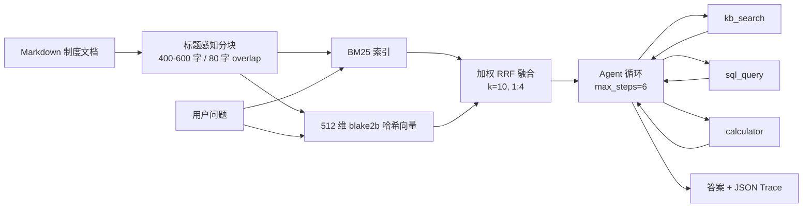

# 星岚企业知识库问答 Agent

一个**只用 Python 标准库**、可完全离线运行的企业知识库问答 Agent：Markdown 文档 → 标题感知分块 → BM25 + 哈希向量 + 加权 RRF 混合检索 → 带工具调用的 Agent 循环 → 可复现的检索与任务评估。

> 这是面向「AI 应用开发 / AI Agent 开发」岗位的 portfolio 项目。重点是链路完整、指标可复现、取舍写清楚，而不是堆框架。

## 1. 架构



核心链路：

1. `chunking.py` 按 Markdown 标题路径切分，再按段落和句子打包，保留标题元数据与约 80 字重叠。
2. `bm25.py` 与 `embeddings.py` 分别构建两个召回臂；Dense 是**字符 bigram 哈希**，不是神经网络语义模型。
3. `retriever.py` 用加权 RRF 融合两个排名，按 `(doc_id, heading_path)` 去重，每个文档最多保留一个结果。
4. `agent.py` 执行函数调用循环，每步记录工具名、参数、成功状态、耗时和结果摘要。
5. `evals/run_eval.py` 计算检索与 Agent 指标，生成中文 Markdown/JSON 报告。

## 2. 快速开始（3 条命令）

要求 Python 3.11+，无需 `pip install`。以下命令均在项目根目录执行：

```bash
python scripts/make_analytics_db.py
python -m kb_agent.cli ingest
python -m kb_agent.cli ask "一线城市出差住宿标准每晚多少钱？"
```

离线模式下 `ask` 使用确定性的 `MockModel`，答案直接摘自 `kb_search` 结果，不调用任何网络。

接着可以运行测试和完整评估：

```bash
python -m unittest discover -s tests -v
python -m kb_agent.cli eval
```

评估产物：`reports/eval-report.md` 与 `reports/eval-report.json`。

可选的真实模型与 Embedding 通过环境变量启用（见 `.env.example`）：

```bash
export KB_LLM_BASE_URL=https://api.deepseek.com/v1
export KB_LLM_API_KEY=...
export KB_LLM_MODEL=deepseek-chat
```

`KB_EMBED_BASE_URL` / `KB_EMBED_API_KEY` 同时存在时，`ingest` 默认走远程 Embedding；显式指定 `--embedder hash` 可强制离线索引。

## 3. 评估结果（test 集，2026-10-26 实跑）

- 检索：30 条问题，按查询类型分层抽样为 **18 条 dev / 12 条 test**；主表只报告 test。
- 语料：13 篇 Markdown，40 个分块。
- 指标：文档级 Recall@1/3/5、MRR、nDCG@5；P95 为 12 条查询实测单次检索耗时。
- 权重：加权 RRF，`score = 1.0/(k+r_bm25) + 4.0/(k+r_dense)`，`k=10`；权重和 k 只在 dev 上扫参选择。

| 配置 | Recall@1 | Recall@3 | Recall@5 | MRR | nDCG@5 | P95 耗时 (ms) |
| --- | ---: | ---: | ---: | ---: | ---: | ---: |
| BM25 only | 0.5000 | 0.6667 | 0.7500 | 0.5903 | 0.6301 | 2.4962 |
| Dense only | 0.9167 | 1.0000 | 1.0000 | 0.9583 | 0.9692 | 1.9310 |
| Hybrid + RRF | 0.9167 | 1.0000 | 1.0000 | 0.9583 | 0.9692 | 1.8007 |

**解读必须诚实：** 这个 12 条 test 切片上 Dense 已经饱和（R@5=1.0），所以 Hybrid 与 Dense 持平，不低于两个单路；收益在 dev 上可见（Hybrid MRR 0.8889 vs Dense 0.8704，nDCG@5 0.9034 vs 0.8889）。不能据此声称 Hybrid 在 test 上超过 Dense。

Agent 任务（20 条：15 条单跳 + 5 条多跳）：

| 指标 | 结果 |
| --- | ---: |
| 任务成功率（总体） | 90.00% |
| 单跳任务成功率 | 100.00% |
| 多跳任务成功率 | 60.00% |
| 工具链完成率（多跳） | 60.00% |
| 平均步数（模型轮次） | 2.50 |
| 平均工具调用次数 | 1.50 |
| 工具调用次数分布 | 1 次 × 15；3 次 × 5 |

多跳失败来自 `MockModel` 的**规则规划器上限 3 步**：两条任务需要“查口径 → 查两个数 → 计算”共 4 步，第 3 步后停止，因此没有完成。这是 harness 的能力边界，不代表真实大模型的能力。

如果写简历，可以引用这三个数，但请同时保留口径说明：

- Hybrid Recall@5：**1.0000**（test 12 条）
- Hybrid MRR：**0.9583**（test 12 条）
- Agent 单跳成功率：**100.00%**；多跳成功率：**60.00%**；总体 **90.00%**

完整报告见 [`reports/eval-report.md`](reports/eval-report.md)，其中包含分类型指标、dev 扫参表、多跳 trace 和失败明细。

## 4. 设计取舍

### 为什么 BM25 + Dense，而不是单路

- BM25 对制度编号、阈值、专有名词和数字很敏感，可解释、无需训练。
- Dense 哈希向量擅长“多个词共同出现”的整体相似度，也能通过查询侧领域同义词表处理口语化问法。
- 单路在不同查询类型上各有明显短板：test 中 BM25 语义型 R@5 只有 0.5000；Dense 在更依赖精确词面的样本上会丢失排序信号。混合检索的价值是**在两类查询之间保持下限**，而不是让所有指标都无条件上涨。

### 为什么是加权 RRF，而不是分数归一化后相加

BM25 分数与余弦相似度量纲不同，直接相加需要为每个查询估计归一化参数，容易不稳定。RRF 只依赖排名，天然免疫量纲。当前实现把权重做成参数，用 dev 扫出 `1:4`、`k=10`；等权 RRF 会被 BM25 在语义型查询上的噪声拖累。**权重是在 dev 上选的，test 只用于最终报告**。

### 为什么 Dense 用 blake2b 哈希向量

哈希向量不依赖模型下载、GPU 或网络，任何时候重跑结果一致。它使用 `blake2b` 派生索引，避免 Python 内置 `hash()` 的随机盐。代价是它没有真正的语义泛化能力；口语化查询的跨词匹配依赖 `retriever.py` 中一份人工维护的领域同义词表，这是明确的局限，不是“语义模型”。

### Chunk 大小与 overlap

- 400–600 字：足够容纳一条制度及其例外，又不会让上下文过长。
- 80 字 overlap：降低跨块边界丢失条件句的概率。
- 先按标题切，再按段落/句子打包，避免在句子中间硬切。
- 表格作为整体单元保留，避免拆散表头和数值。
- 语料只有 600–900 字，部分小节天然短于 400 字，因此实际分块会出现 100–400 字的小块；这不是按固定窗口切分的结果。

### 为什么只用标准库

面试时可解释每一行；离线可复现；没有框架版本和网络依赖。代价是缺少 ANN、分词器、异步和成熟的工具编排，规模化时需要替换。

## 5. 测试

```bash
python -m unittest discover -s tests -v
```

共 16 个测试，覆盖：分块标题与 overlap、中文 bigram 分词、BM25 排序、加权 RRF、去重、向量索引存取、计算器白名单、SQL 只读与多语句拦截、Agent 步数上限、MockModel 工具调用、eval 3 条 smoke。

## 6. 目录结构

```text
kb-agent/
├── kb_agent/                 # 核心包，仅标准库
│   ├── chunking.py
│   ├── embeddings.py
│   ├── bm25.py
│   ├── index.py
│   ├── retriever.py
│   ├── llm.py
│   ├── tools.py
│   ├── agent.py
│   └── cli.py
├── data/
│   ├── corpus/               # 13 篇中文制度文档
│   └── analytics.db          # 确定性生成的分析库（git 忽略）
├── evals/
│   ├── qa.jsonl              # 30 条检索问题（dev/test + 类型）
│   ├── tasks.jsonl           # 20 条 Agent 任务（单跳/多跳）
│   └── run_eval.py
├── reports/                  # 评估产物（git 忽略）
├── scripts/make_analytics_db.py
├── tests/test_kb_agent.py
├── server/app.py             # 可选 FastAPI
├── integrations/             # LangChain / Dify / n8n 参考适配
├── docs/ARCHITECTURE.md
├── docs/INTERVIEW.md
├── .github/workflows/ci.yml
├── Dockerfile
├── requirements-optional.txt
└── README.md
```

## 7. 工具安全

- `sql_query`：SQLite `mode=ro` URI 只读打开；只接受单条 `SELECT` / `PRAGMA`；去掉一个尾分号后仍含分号即拒绝；限制 100 行；只读连接保证写操作失败。
- `calculator`：AST 白名单只允许数字、括号、`+ - * / // % **` 和一元正负；拒绝 Name、Call、Attribute；显式拒绝 `__import__` 与双下划线。
- `kb_search`：k 限制在 1–10，返回原文片段和来源，便于引用。
- API Key 只从环境变量读取，不打印、不写日志。

## 8. 局限

1. **Dense 不是神经语义模型**：字符 bigram 哈希 + 人工领域同义词表，语义型查询的收益部分来自同义词表，存在设计者偏差。
2. **MockModel 不是真实 LLM**：它是确定性规则规划器，能力上限 3 步；90% 任务成功率只验证 Agent 循环与工具编排，不代表生产环境模型表现。
3. **评估集很小**：30 条检索问题（test 仅 12 条）、20 条任务、13 篇虚构文档，没有人工双标注，指标波动大。
4. **单机内存检索**：BM25 与向量都线性扫描，P95 仅代表小语料；10 倍语料需要 ANN、倒排索引和缓存。
5. **真实 API 未在无网络环境验证**：`OpenAICompatModel` / `OpenAICompatibleEmbedder` 是 urllib 实现，需配置网络和密钥后自测。

## 9. License

MIT，Copyright (c) 2026 zhibo。见 [`LICENSE`](LICENSE)。
